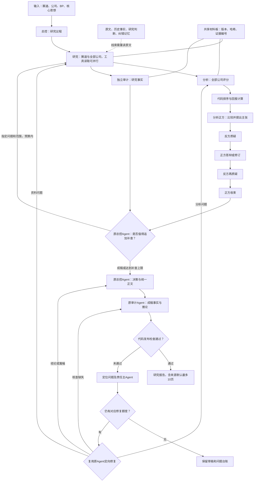

# AI 赛道投研多智能体平台

选择一个 AI 细分赛道，可手动指定 1–5 家未上市公司，也可让研究员按填写的数量推荐。**AgentScope 2.0.11** 的五个 Agent 分别承担总控、资料研究、投资分析正方、独立反方和审计。投资报告默认含来源与附录最多 10 页，可在研究设置中调至 25 页。模型主要通过 OpenRouter 调用，也支持 Anthropic 直连。

> 当前可在演示模式运行完整流程。真实模型、搜索质量、成本和耗时仍需用真实案例验证。

## 架构

当前实现、主Agent职责、材料版本交接和并行边界见 [四模块架构](docs/four_main_agents.md)。[上一版并行架构](docs/agentscope_architecture.md)作为 expanded 扩展模式保留；原 PNG/SVG 是历史记录。



| 智能体 | 职责 | 默认模型（OpenRouter） | 联网 |
|---|---|---|---|
| 总控与决策 `lead` | 核心思想、研究议程、最终建议与统一正文 | `google/gemini-4-carbon` | |
| 资料研究 `research` | 赛道及全部公司，检索、原文、上传资料与纠错 | `moonshotai/kimi-k3.1-pro` | ✅ |
| 投资分析 `analysis` | 全部公司评分、比较、正方论证 | `anthropic/claude-fable-5.2` | |
| 独立反方 `bear` | 两次检验正方最近的主张，提出可检验的异议 | `openai/gpt-6.2-astra` | |
| 独立审计 `audit` | 研究事实核查、修正复查、成稿与核心推论审查 | `z-ai/glm-5.3-prime` | ✅ |

联网搜索工具用 `perplexity/sonar`，同样走 OpenRouter。

局部复核使用 `google/gemini-3.1-flash-lite`，通过现有 `OPENROUTER_API_KEY` 按最低思考级别调用。引用字段复核判断标点、全半角、大小写或单位换算是否等价。成稿金额复核对照原文表头和对应数值行。只有能确认等价时才撤销对应告警。

模型在 `models.yaml` 的 `rejection_review` 中配置。每份任务最多六组复核，每次最多45秒和1200输出token，相同输入复用结论。可用 `Settings(rejection_review_enabled=False)` 关闭。复核记录和费用保存在 `result.json` 的 `rejection_reviews` 及 `audit.md`。[引用复核提示词](prompts/rejection_review.md) · [成稿金额复核提示词](prompts/report_amount.md)

引用复核支持用 `python -m evaluation.rejection_review_smoke --live` 单独验证。该命令使用当前配置的复核模型，一次请求比较九个虚构样例。

**设计原则**
- **主线先行**：主 Agent 先提出核心问题、待证伪假设、最多三个优先因素与反证检验；用户可用 `--core-idea` 指定希望检验的思想，用 `--selection-rationale` 给出选择理由。研究按问题取证，证据可以推翻初始假设。
- **补查门槛**：被审计判为不实或无法核实的证据从补查回答依据中排除，但不再阻止整个问题循环；只有研究核查缺失时才跳过。这些问题仍由原纠错与发布检查处理。
- **提示词版本**：每次运行在 `result.json` 的 `prompt_versions` 记录五个 Agent角色提示词与 `prompts/` 文件的内容哈希，审计台账同步展示，便于比较不同版本提示词产出的报告。
- **四个模块、五个 Agent**。总控、研究和审计各一个，投资分析模块两人分工，各自复用上下文。
- **问题驱动补查**：保留原研究、评分、审计和报告流程，在研究核查后判断是否还有可能改变结论的问题。默认最多追加一轮，每轮最多两个指定范围任务；公司补查只重算受影响公司的评分，重新比较和审计。重复任务、无新材料或预算不足时进入原成稿流程。`--research-refinement-rounds 0` 可关闭，最大为2。
- **有限并行**：研究工具可并行读取，分析与独立审计可同时处理同一版研究包；评分完成后立即开始比较，与仍在进行的审计重叠。其他阶段按明确依赖执行。
- **运行管控**：整份任务共用总时限（默认 90 分钟）、接口重试总预算（默认 12 次）和可选费用上限；到时或取消后不再发起新的模型与工具调用，并保存已完成部分。本轮相同的搜索与网页读取只执行一次，同一供应商的请求按并发与每分钟配额排队，429 限流时整队等待。
- **核查覆盖门槛**：研究核查的必查清单由代码给出：赛道 1 条、每家公司默认 2 条，按估值、融资、收入、客户优先。覆盖不足会退回审计主Agent补查，仍不足则不能作为正式报告。
- **结构化交接**：共享材料板保存不可变快照，按版本号、哈希和证据编号交接；读者拿到副本，过期或被篡改的材料会被拒绝。
- **受控记忆**：公共原文、已核查历史事实、研究判断与纠错分开存储。记忆只作线索，必须重新读取原文获取本轮引用；草稿不能晋升事实记忆，私有资料不自动进入公共记忆。
- **案例验证的方法经验**：实际补查任务经独立审计后，导出时再检查执行记录、研究版本、当前事实核查、公共原文和发布状态，合格方法才进入独立方法表，供下一次规划参考。方法只在对应案例验证，不作为公司事实或自动改写提示词。可用 `python -m evaluation.research_method_replay <result.json>` 离线回放。
- **实际页数检查**覆盖正文、引用和附录。默认最多 10 页，网页或 `--report-max-pages` 可在 1–25 页之间设置，成稿字数预算随页数调整。PDF 预检超页时由总控压缩，随后复查事实与投资判断。导出仍超页时保留研究记录与状态说明。
- **数字由代码算**：加权分、TOPSIS、经营与市场指标、MOIC、简化年化 IRR 和用户情景权重下的期望倍数由代码计算；模型负责整理资料、解释和明确假设。输入不足时不计算。
- **原文读取与摘录匹配**：保存工具实际读到的正文；核查员给出可检查的来源和短摘录，无法同源匹配的肯定或否定结论降为无法核实。匹配只证明摘录存在，不能证明语义支持或来源内容真实。
- **两轮投资辩论**。正方提出 → 反方质疑 → 正方答辩或修订 → 反方再次质疑 → 正方收束。正方每次回应都提交当前结论和答辩理由。总控看到完整交锋，独立审计负责事实与推论复核。
- **只有研究与审计联网**：其余主Agent读取有版本的结构化材料，降低网页里提示词注入的影响。
- **跨模型检查**：默认独立审计与被检查的研究、分析、总控使用不同厂商；自定义配置时可保持这一分工。
- **结构化输出**：AgentScope 使用原生 `GenerateStructuredOutput` 按 JSON Schema 提交；引用和内容检查通过中间件执行。直接输出 JSON 文本时可兜底解析。连续三次截断停止该角色。
- **失败定向修复**：发布未通过先定位材料和责任主Agent，回传研究、分析、总控或审计执行对应修复，再独立复查并重新检查。默认最多两轮发布修复，原研究补查最多一轮；达到对应上限或仍缺少依据时保留草稿。修正研究后重算下游，分析错误只重新提交涉及公司的分析。
- **上市状态**：研究员判为已上市的公司不参与候选排序；无法确认上市状态时在报告中标注“未确认”。

## 报告结构

单公司报告主标题由本次研究对象生成，格式为“公司名 投资报告”。副标题概括本案的研究主题。正文依次为投资摘要、公司概况与客户需求、核心技术与竞争壁垒、商业模式与经营质量、估值与回报情景、关键风险与尽调优先级、资料来源与测算口径。各章首段承接前章能证实的结论，涉及收入归因、盈利与估值的假设在相应章节标明。[单公司成稿模板](docs/single_company_memo_template.md)

多公司比较使用“赛道名 投资报告”，以公司间的取舍组织七章。

1. 投资价值与技术护城河。首页突出一项持续投入有价值的能力，给出技术归属、事实依据、对手复刻难度与失效条件。
2. 赛道和市场：市场空间（含赛道级 TAM/SAM/SOM 测算）、为什么是现在、行业格局、参照公司
3. 公司比较与排序：各公司最突出的一点及其胜出机制、各维度得分、加权分和一行排序不确定性；评分方法细节在附录
4. 各公司研究摘要：产品与商业模式、团队、经营事实与按赛道选择的经营测算、融资与上市状态、亮点与担忧
5. 共同风险：风险、影响、依据与信息缺口、应对
6. 首选公司深入分析。解释主判断的机制、竞对差异、投入与成本、长期竞争力。交易与估值小节承接投资动作、推进条件与报价依据，并列示退出回报和下行风险。
7. 尽调计划与附录。列明信息缺口、保留意见、方法与假设、测算输入和原始来源。研究轮次、双方发言和修订轨迹保存在审计台账。

分析主 Agent 为每家公司提交 `standout`、`competitor_diffs`、`cost_structure`、`long_term_edge`。总控提交 `technical_moat`、`core_answer`、`question_answers`、`selection_view` 和 `gap_impacts`。首页技术护城河作为 M1 与投资逻辑一起接受逐项独立复核。

[多公司投资报告模板](docs/investment_memo_template.md)保留公司比较和重点标的分析。优先清算权等交易条款、逐年财务预测和资金用途以获得的原始材料为准。

## 快速开始

使用 Python 3.11 或更新版本。在 Windows PowerShell 中运行以下命令。

```powershell
git clone https://github.com/litianhao738/ai-vc-multiagent.git
cd ai-vc-multiagent
python -m venv .venv
.\.venv\Scripts\Activate.ps1
python -m pip install -r requirements.txt
```

在已激活的环境中启动网页。演示模式无需 API 密钥。

```bash
python -m streamlit run app.py
```

界面默认使用免费的演示模式。真实研究需在 `.env` 中配置有效的 `OPENROUTER_API_KEY`。「研究公司数量」可直接输入 1–5，网页默认 3 家。切换「手动指定」和「由研究员推荐」会保留填写的数量。每家公司都可上传 PDF、TXT 或 Markdown 资料。真实研究可设置费用停止阈值，达到后停止发出新请求，在途请求仍可能计费。结果区显示本次研究耗时和 API 已回传的费用。

### 生成时间与费用参考

按 2026 年 11 月 19 日默认模型价格重算，两份旧版三公司研究草稿的用量如下。回算将研究与补查归入 Kimi，评分、比较与正方归入 Claude，反方归入 GPT，事实复查归入 GLM，总控归入 Gemini，另计 Sonar 的搜索和 token 费用。使用目录公布的文本输入、输出价格，按未缓存输入计算。[OpenRouter 模型目录](https://openrouter.ai/models)

| 旧版真实任务 | 当时的研究耗时 | 当时已返回的费用 | 按当前价格回算 |
| --- | ---: | ---: | ---: |
| AIGC 三公司草稿 | 44.8 分钟 | $2.91 | $8.67 |
| 具身智能三公司草稿 | 41.0 分钟 | $3.84 | $10.17 |

三公司标准任务可先预留 **45–90 分钟、10–20 美元**。这一区间包含对额外辩论、补查和定向修复的余量。新版尚待真实端到端计时，缓存、服务商路由、模型输出量及修复次数都会影响账单。默认单次运行时限为 90 分钟，超时会保留部分记录。

网页只要求填写公司名称，也可选择“由研究员推荐”。官网、资料和全部数值均可不提供。交易金额与经营JSON位于每家公司默认收起的可选区，持有期、稀释比例、情景权重及市场JSON集中在“补充回报与市场测算（可选）”；数字框默认留空，无需用0表示未知。金额单位为百万美元，50代表5000万美元。明确填写的0稀释比例会保留；稀释留空沿用报告中明确标注的50%研究假设。情景权重不完整或合计不为100%时，仅跳过期望倍数测算，其他研究照常进行。

在「研究对象 → 研究赛道」中可以选择已有赛道，也可以输入新名称并按回车保存，下次打开仍可选用。完成研究后可下载 PDF、Markdown、结构化结果与证据台账。展开「历史报告」可按赛道筛选、搜索公司名称或日期，并下载原文件。

```bash
python cli.py --sector aigc-content --company 甲公司 --company 乙公司 --company 丙公司 --mock
python cli.py --sector "工业视觉质检" --company 甲公司 --mock
```

`--mock` 是演示模式，不调用任何模型和搜索，只用来检查流程和报告结构。接入真实模型：

1. 复制 `.env.example` 为 `.env`，填入 `OPENROUTER_API_KEY`
2. 运行：

```bash
python cli.py --sector aigc-content --company "Pexo|https://pexo.ai" --company HeyGen --company Higgsfield --post-money Pexo=50
```

```bash
python cli.py --sector embodied-ai --max-companies 4
```

不指定公司时，由赛道研究员推荐候选公司。研究、事实核查、成稿一致性与实际页数检查通过后生成 `outputs/<赛道>_<时间>_<运行ID>/report.md` 和 `report.pdf`，内部台账为 `audit.md`，结构化结果为 `result.json`。研究或核查未完成时保存 `research-draft.md/pdf`；超页时只输出简短状态页，完整材料保存在结构化结果。上游修正后重新分析失败则保存 `partial-result.json`。演示稿始终标注模拟数据；网页可下载 PDF、Markdown、JSON 和审计台账。

| 参数 | 说明 |
|---|---|
| `--company "名称\|官网"` | 要分析的公司，可多次使用 |
| `--max-companies` | 研究员推荐的公司数量，可填 1–5，命令行默认 5。手动指定时为本次允许的公司数上限 |
| `--doc 公司名=文件路径` | 该公司的 BP 或其他资料（PDF/TXT/MD） |
| `--post-money 公司名=50` | 本轮投后估值（百万美元），用来计算回报倍数和隐含 ARR 倍数 |
| `--investment 公司名=5` | 拟投资金额（百万美元），用来计算拟持股比例和本基金退出所得 |
| `--round-size 公司名=10` | 本轮融资总额（百万美元），用来计算投前估值和本轮后现金跑道 |
| `--exit-dilution 0.5` | 投资后至退出时的持股稀释比例；不填时用系统默认 0.5，报告标注为“系统默认” |
| `--holding-years 6` | 用户假设的持有年数；未提供时不算简化年化 IRR |
| `--scenario-probability 乐观=0.2` | 三种情景权重分别提供，合计须为 1；未提供时不算期望倍数 |
| `--management-fee 0.02` / `--carry 0.2` | 年管理费率和超额收益分成，用于扣费后回报的单项目近似测算；默认 2% 和 20% |
| `--liquidation-preference 1` | 优先清算倍数（不参与分配型）；需同时提供下一项，否则不测算 |
| `--preference-stack 公司名=600` | 与本基金同顺位的优先股清算额合计（百万美元，含本基金） |
| `--financial-data 公司名=文件.json` | 公司经营输入：带单位、期间和逐项来源说明的收入、成本、留存、现金或硬件交付数据 |
| `--market-data 文件.json` | 赛道级市场输入：目标客户数、客单价、相关总市场及各比例假设 |
| `--agent-layout core` | 默认：五个固定 Agent；`expanded`为上一版细分模式 |
| `--pairwise-checks` | 仅 expanded：额外正反顺序两两比较 |
| `--focus` | 希望重点关注的问题 |
| `--core-idea` | 主 Agent 应检验的核心研究思想，允许被证据推翻 |
| `--selection-rationale` | 为什么选这些公司；作为待检验命题，报告说明证据支持到什么程度，不填时如实写明未说明理由 |
| `--max-workers 4` | 任务与工具的并行额度。core 模式使用四个模块、五个常驻 Agent。 |
| `--run-timeout-minutes 90` | 整份任务总时限；到时停止并保存部分结果，0 表示不限 |
| `--retry-budget 12` | 整份任务可用的接口重试总次数，不随 Agent 或请求数放大 |
| `--max-cost-usd 20` | 费用硬上限；只统计接口返回了费用的请求，不填则不限 |
| `--provider-concurrency 8` / `--provider-rpm perplexity=60` | 同一供应商的在途请求数与每分钟请求数；供应商是模型名前缀 |
| `--audit-claims-per-company 2` | 研究核查时每家公司至少核查的关键主张数，1–4 |
| `--research-lanes 3` | 仅 expanded：每家公司研究分工数，1–3 |
| `--memory-path 文件.sqlite3` / `--no-memory` | 按项目隔离记忆库，或禁用跨任务记忆 |
| `--report-max-pages 10` | 含来源与附录的实际 PDF 页数上限，默认 10，可选 1–25 |
| `--models` | 换一份模型配置文件 |
| `--list-sectors` | 列出内置及已保存的自定义赛道名称和配置标识 |
| `--index-reports` | 补录已有归档并刷新文件索引，可用 `--out` 指定其他归档目录 |

经营输入格式见 [软件公司演示 JSON](examples/financial_inputs.example.json) 和 [硬件公司演示 JSON](examples/hardware_inputs.example.json)，市场输入见 [市场演示 JSON](examples/market_inputs.example.json)。报告只展示赛道配置 `metrics` 中适用于该商业模式的指标。金额统一百万美元，比例用 0–1，来源说明由用户提供且未经自动独立核验；不得把不同期间和币种混用。已计算指标与原始输入会同时写入报告。适用条件和公式见 [报告质量与计算说明](docs/report_quality.md)。

## 配置

在项目根目录的 `models.yaml` 为每个角色选择支持工具调用的模型。`anthropic/claude-fable-5.2` 通过 OpenRouter 调用。需要直连 Anthropic 时可填 `anthropic:claude-fable-5-2` 并配置 `ANTHROPIC_API_KEY`。[OpenRouter 模型列表](https://openrouter.ai/models)

**赛道与评分**　网页和命令行均可直接输入赛道名称。AIGC 内容、具身智能使用各自的专用评分标准。新赛道采用 `sectors/templates/general.yaml` 的通用 VC 评分维度，研究员根据资料识别适用指标与可比对象。需要预设行业专用权重时，可在 `sectors/` 下增加 YAML。每份新报告的结构化结果保存本次使用的评分配置。

**项目数据库**　首次使用时会在 `data/project.sqlite3` 建立赛道和报告索引。新报告和未完成记录在保存时自动登记。索引保存赛道、公司、日期、状态、已有页数及原文件位置，PDF 和 Markdown 正文保存在原目录。已有项目可运行 `python cli.py --index-reports` 补录 `outputs/` 及 `output/pdf/` 中的独立导出，重复执行会更新同一条记录。历史来源及研究记忆使用原有的独立数据库。

## 测试

```bash
python -m unittest discover tests
```

测试不调用任何模型，覆盖完整流程、未指定公司时的推荐流程、智能体循环的纠错逻辑、评分和 TOPSIS、回报倍数、赛道配置校验、模型配置覆盖和工具安全检查。

新架构离线演示（五家虚构公司，包含资料工具、经营与市场测算及实际 PDF 分页）：

```bash
python -m evaluation.agentscope_demo
```

演示 PDF 保存为 `output/pdf/four_main_agents_demo.pdf`，完整结果另存于 `outputs/agentscope-demo/`。输出会列出实际主Agent数量与阶段调用次数；它检查实际 AgentScope 链路和报告布局，不验证投资结论质量。

需要验证真实核查模型时，可以运行下面的虚构 BP 测试。它会调用所配置的事实核查模型并产生 API 费用，结果保存在 `outputs/evaluation/`。测试只检查 15 条已知公司自报主张，不代表真实数据或联网核查的准确率。

```bash
python evaluation/fact_checker_smoke.py
```

另有一组人工核对的 [具身智能公开事实小样本](evaluation/real_fact_baseline.md)，用于检查公司口径、上市状态、订单与收入的区别；它不是历史投资回测。演示步骤见 [10 分钟演示脚本](docs/demo.md)。

## 历史案例回测

准备 5–10 个历史报告的 `result.json`，以及对应时点和后来发生的事件，写入案例文件。文件中的报告路径相对于案例文件所在目录：

```json
[
  {
    "result": "case1/result.json",
    "as_of": "2022-12-31",
    "outcomes": {"公司甲": "融资", "公司乙": "倒闭", "公司丙": "未知"}
  }
]
```

```bash
python backtest.py cases.json --out backtest-result.json
```

工具汇总每个报告首选公司的后续事件。融资或收购并不等于投资回报，回测不能自动排除搜索资料中的事后信息，需要人工检查。`as_of` 只是案例记录，不会限制联网搜索。

## 目录

```
cli.py                命令行入口
app.py                Streamlit 网页入口
backtest.py           汇总历史报告与用户提供的后续结果
evaluation/           可重复运行的真实模型小样本核查测试
models.yaml           每个角色用哪个模型
sectors/              赛道配置
vcagents/
  config.py           运行配置
  llm.py              模型接入（OpenRouter / Anthropic 直连 / 演示模式）和按角色分配模型
  tools.py            工具：Sonar 联网搜索、网页抓取、上传资料检索
  knowledge.py        公开来源原文快照、中文关键词/BM25 检索与分块回读
  corrections.py      主席发现问题后定位上游事实材料
  sectors.py          读取和校验赛道配置
  schemas.py          各智能体的输出格式与校验
  roles.py            8 个智能体的角色与提示词
  agent.py            单个智能体的工具调用循环
  runtime.py          AgentScope 2.x 原生运行层与提交检查中间件
  scheduler.py        按依赖执行的有界异步任务图
  memory.py           带来源与核查门槛的历史事实、判断和纠错记忆
  scoring.py          加权分、TOPSIS、回报倍数
  pipeline.py         细分扩展流程，以及共用的证据、计算和发布门槛
  main_pipeline.py    默认五 Agent工作流与上下文复用
  main_roles.py       五个 Agent的职责与提示词
  handoffs.py         共享材料板、版本与哈希交接检查
  report.py           渲染 7 部分报告及独立的内部审计台账
  brief.py            默认对外报告：核心判断优先、减少重复、只保留使用的来源
  pdf_report.py       PDF 导出及最多25页的实际分页检查
tests/                不依赖模型的测试
```

## 可复用的外部资源

以下资源目前是参考资料，不作为运行时 Skill 加载；其中 returns-analysis 的方法已改写进代码。使用前应按具体文件核对许可证、保留必要的版权声明，并针对早期 VC 投研调整。

| 资源 | 可复用内容 | 建议 |
|---|---|---|
| [Bessemer：Shopify 投资备忘录](https://www.bvp.com/memos/shopify)、[Wix 投资备忘录](https://www.bvp.com/memos/wix) | 投资建议、理由、风险和交易背景的呈现方式 | 报告结论部分借鉴结论先行与关键事项前置的写法；不复用原文，不假设已有交易条款 |
| [Anthropic Financial Services](https://github.com/anthropics/financial-services) | 赛道概览、交易筛选、单位经济、尽调清单、回报分析、IC memo | returns-analysis 的敏感性表与扣费后口径已改写为代码（`financials.returns_analysis`），并补充优先清算权；其余 Skill 仅作参考。仓库为 Apache-2.0 |
| [fact-check-workflow](https://github.com/jamditis/claude-skills-journalism/blob/master/journalism-core/skills/fact-check-workflow/SKILL.md) | 主张提取、证据记录、判断与更正流程 | 参考核查工作流和记录格式；仓库为 MIT |

安装到 Codex 的 Skill 不会自动进入本项目运行时；默认五 Agent使用 `vcagents/main_roles.py` 的提示词，旧分工保留在 `vcagents/roles.py`。
各项投资框架、算法和外部项目的实际使用情况见 [投研框架与复用情况](docs/reuse-audit.md)。
公开数据 API、原文归档、RAG 索引和实际接入范围见 [数据来源与可追溯检索](docs/data_sources_and_rag.md)。现有工具循环已支持 FunctionTool 式调用；本轮实际增加的是 `search_knowledge`、`read_source` 和来源快照，不是只引用框架名称。
各候选的适配性和已执行的对照实验见 [Skill 与外部项目评测记录](docs/skill_evaluation.md)。
整套 PE 交易流程、新闻采访发布流程及 SAFE/Loki/GPT-Researcher/STORM/TradingAgents/RankGPT/pyDecision 均未接入正式流程，已从主候选清单移除；历史审阅保留在评测记录。未改动用户全局安装的 Skill。

## 已知限制与待验收项

- **来源与核查**：工具返回的原文按句编号，研究员和核查员提交引用位置，摘录由代码取出；每条证据只写一个事实。上传资料按公司、文件、页码和内容版本区分，同名 BP 不共用引用。分析师以已定位原文为事实输入，其他角色的摘要不视为新证据。事实数字和明确算式须复核；内容检查最多退回两次，仍未解决时保留材料并阻止正式出稿。研究材料分批抽查，最终正文另抽查最多6条事实，并逐项复核全部核心投资理由、估值及最终建议。正文更新后旧推论核查失效；抽查指标不能代表全文准确率，公司自报仍按公司披露呈现。详见 [报告质量说明](docs/report_quality.md)。
- **修正流程**：明确错误和缺少原文支持的主张都退回补查、更正或删除，保存前后材料、重跑受影响分析与排序并复查。主席新增发现的问题通过全文或证据 ID 回传上游，不能可靠定位语义改写。修正后复查仍未解决的问题不再重试，记入未解决清单，结果只输出研究稿 `research-draft.md`，不输出正式 `report.md`；内部状态与被删除的原主张保存在审计台账，正式正文不以状态标签保留无依据事实。
- **运行指标**：记录角色 token、各角色及总耗时、格式失败次数和搜索次数；各角色可并行，耗时不可直接相加。费用只有在接口返回时才统计，未返回的费用标为未知，不能把部分费用当作总费用。
- **失败记录**：流程因普通异常中断时保存 `partial-result.json`，包含已完成材料、错误和可获得的用量，不生成完整报告；进程被强制终止时无法保证保存。
- **BP**：PDF 使用文本提取，不支持扫描件 OCR；TXT 和 Markdown 使用 UTF-8 文本。
- **真实案例与回测**：已用真实 OpenRouter 请求和多次端到端尝试验证；一份具身智能草稿的整体核查未完成，AIGC 任务中途停止，最新三家公司复测的主席调用因接口 HTTP 402 失败并保存部分结果，均未通过完整验收。详情见 [验证记录](docs/validation.md)。目前还没有两份通过验收的示范报告或历史回测；已提供演示脚本。
