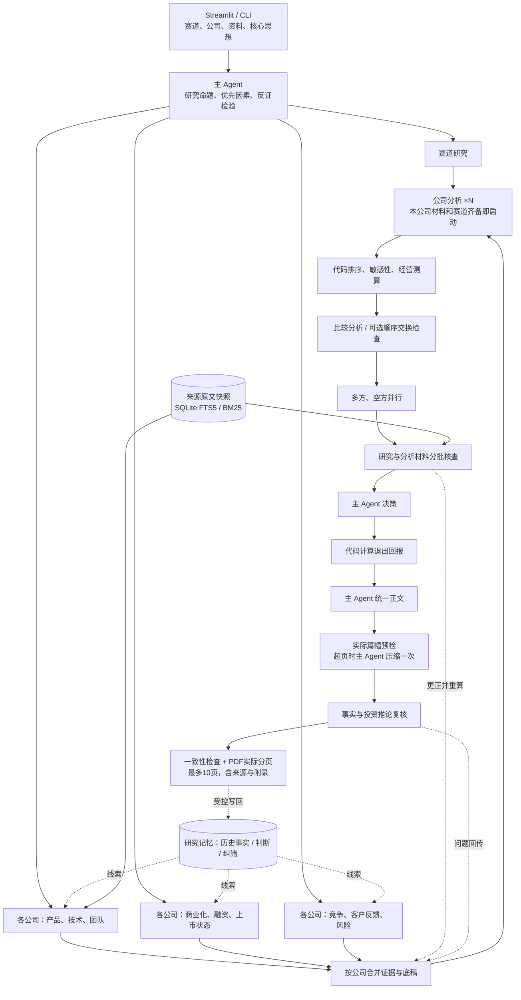

# AgentScope 并行投研架构

> 当前默认已收敛为四个主Agent，请阅读 [当前默认架构](four_main_agents.md)。本文件保留上一版细分并行模式及其证据、记忆、报告设计；该模式现在须显式选择 expanded。

设计与实现日期：2026-11-14。接口固定为 AgentScope **2.0.11**，Python 3.11+。本文件描述当前接入代码；真实模型的耗时、成本与报告质量需要另行验收。

## 目标与主 Agent 的核心思想

输入赛道、公司、公开来源、私有资料和交易假设，生成**含引用与附录最多十页**的投资研究报告。主 Agent 围绕三个问题组织工作：

1. **价值由谁捕获**：客户为什么持续付费，价值落在模型、应用、渠道还是交付环节？
2. **凭什么持续**：为什么是现在、为什么是这家公司；技术、分发、客户关系和单位经济是否支持这一判断？
3. **什么价格有回报**：经营优势是否足以支持当前交易价格；哪些证据会推翻判断？

用户的 `core_idea` 和 `focus` 是研究议题。主 Agent 先提交 `RESEARCH_PLAN`，包含一个核心问题、一个待证伪假设、最多三个优先因素和三项反证检验。研究员同时收集支持与反对证据；最终建议依据当前证据及实际回报形成，允许不投。

主 Agent 使用主席模型，分为研究议程、最终决策、统一正文三个调用上下文。议程没有提前投资建议；正文复核锁定评分和退出情景，并依据实际计算结果调整措辞与投资建议。

## 总体结构

## 运行层与并发

`vcagents/runtime.py` 为实际运行层：

- 使用 AgentScope 原生 `Agent`、`Toolkit`、`FunctionTool`、`AgentState` 和结构化输出。
- `SessionModel` 把现有 OpenRouter / Anthropic / Mock 会话适配到 AgentScope `ChatModelBase`。模型接入与运行循环分别维护。
- 实际模型每次调用都从当前 AgentScope 消息状态重建请求，遵守上下文压缩与工具结果裁剪；Anthropic 工具轮次保留签名思考块。
- AgentScope 执行 reasoning/acting 循环和可并行的工具调用，提交通过原生 `GenerateStructuredOutput`。
- `SubmissionGuard` 在结构化提交中调用原有引用及事实数字检查，错误回传模型修正。多次修正仍不通过时记录未解决问题，禁止正式出稿。
- 每个 Agent 使用独立上下文；其他 Agent 的观点仅作为待审研究意见。来源与证据通过结构化对象共享。

`vcagents/scheduler.py` 使用有依赖的异步任务图，默认允许 **12 个 Agent 同时工作**，可设为 1–32。网络工具在本次 Pipeline 内另设共享并发上限，为 Agent 上限的两倍。

每家公司默认三个研究分工。五家公司会创建十五个公司研究 Agent，另有赛道研究 Agent；并发上限控制实际同时运行的数量。公司分析依赖本公司的合并材料和赛道研究，不等待所有公司的研究完成。默认一轮多空观点；两两比较保持可选，避免额外平方级调用成为默认成本。

合并器执行来源重编号与整段材料合并，不额外生成衔接事实。分工失败保留错误，成功分工仍可进入草稿研究；所有分工失败则阻断该公司分析。赛道失败或所有公司分析失败中断整轮。

## 记忆与证据的边界

| 范围 | 内容 | 可否直接支持当前事实 |
| --- | --- | --- |
| AgentScope `AgentState` | 本 Agent 的任务、消息、工具结果 | 须回到已读原文核对 |
| `KnowledgeStore` | URL、原文、快照 ID、SHA256、时间、分块位置 | 读取后获得本轮来源与句子编号，再引用 |
| `ResearchMemory.fact` | 已核查、能定位公共快照的历史事实，保留公司口径 | 必须重新读取来源；不携带可直接引用的旧证据 ID |
| `ResearchMemory.hypothesis` | 历史研究建议、状态与推翻条件 | 研究意见，不是事实证据 |
| `ResearchMemory.correction` | 曾经不实、缺少支持或被更正的主张 | 用于避错，禁止当作正确事实引用 |
| 本次上传资料 | 按公司隔离的 `DocumentStore` | 按资料页读取，保留公司披露性质 |

公共来源仍保存在 `data/sources.sqlite3`，新增研究记忆保存在 `data/memory.sqlite3`。可用 `--memory-path` 为不同项目设置不同库，或 `--no-memory` 完全禁用研究记忆。

事实写回必须同时满足：

1. 当前报告通过发布检查，没有未解决问题或角色错误。
2. 研究证据已关联来源且通过原文定位。
3. 核查结果为属实或公司口径、完全支持，并通过摘录检查，且明确关联该证据 ID。
4. 存在公共 URL、快照 ID 和正文哈希。

只有原文匹配、未经核查的模型文字、上传 BP 都不能进入事实记忆。使用过私有资料的运行不向共享库自动写入研究判断与纠错文字。模拟模式不读写研究记忆。

检索固定赛道和公司范围，返回过期与冲突标记，默认有效期三十天。历史观点和旧快照不构成新的独立来源。互相矛盾的记忆保留并提示补查；纠错会使同公司、同赛道、同原句的旧事实失效。语义改写的关联仍需要核查模型处理。

这一设计减少无依据的复用和重复犯错，不能保证消除幻觉。现阶段先用可定位文本和显式记录，后续向量召回应以实际漏召回评测为依据增加。

## 报告的十页预算

默认对外渲染器为 `vcagents/brief.py`，完整材料继续保存在结构化结果和内部审计中。对外报告保留七部分，内容预算如下：

| 内容 | 目标页数 |
| --- | --- |
| 投资结论、核心判断、最多三条逻辑、风险与推进条件 | 1 |
| 赛道与市场 | 1 |
| 公司比较、评分与排序不确定性 | 1 |
| 各公司摘要 | 2 |
| 共同风险 | 1 |
| 重点公司经营、估值、辩论和实际回报 | 2 |
| 尽调计划、假设及使用到的来源 | 2 |

这是内容分配，不强制填满十页。正文只保留当前使用的引用及其来源；引用支持链仍需闭合，不能以删除出处节省页数。

`pdf_report.py` 用 ReportLab 生成 A4 PDF，再由 pypdf 读取实际页数。正文复核后先预检版面；超页时主 Agent 压缩一次重复背景和次要叙述，再做最终事实与推论核查。正文字号最低 10pt，不截断风险或结论。导出时再次检查实际页数，仍超过上限则阻止发布，保留研究材料，只输出简短草稿状态页。压缩后的正文不能沿用旧的推论通过记录。

输出目录包含：

- `report.md`、`report.pdf`：发布检查通过的研究报告；演示稿始终注明模拟数据。
- `research-draft.md`、`research-draft.pdf`：核查未完成或不通过的草稿；超页时是状态说明。
- `audit.md`：研究议程、任务依赖、证据、纠错、检查问题和用量。
- `result.json`：完整结构化材料、任务轨迹、记忆写回统计与 PDF 页数。
- `partial-result.json`：运行中断时可保存的部分结果。

## 后续需求的接入位置

| 新需求 | 接入位置 |
| --- | --- |
| 核心投资思想、重点问题 | `SectorRequest.core_idea`、`focus`、主 Agent 提示词 |
| 新的赛道维度、权重、经营指标 | `sectors/*.yaml` |
| 新研究分工或不同并行策略 | `RESEARCH_TRACKS`、`TaskNode` 依赖关系 |
| 新资料工具、向量召回 | `Toolbox`、来源快照层，保留引用验证接口 |
| 新记忆策略 | `ResearchMemory` 的检索、写回与失效规则 |
| 新报告布局 | `brief.py`、`pdf_report.py`，保留实际十页门槛 |

当前仍是 Streamlit/CLI 单机应用。AgentScope 的会话状态已用于运行，尚未接入跨进程自动恢复、多用户权限或分布式队列。真实联网模型需另做完整验收；离线通过不代表事实准确率或成本、时效已经达标。

## 参考与取舍

- [AgentScope 2.0.11 发布](https://github.com/agentscope-ai/agentscope/releases/tag/v2.0.11)：固定运行依赖版本，避免混用 1.x `ReActAgent` 教程和 2.x API。
- [AgentScope 2.0.11 Team Pipeline](https://docs.agentscope.io/en/versions/2.0.11/building-blocks/pipeline/team)：参考主 Agent 统筹、成员独立上下文和并行工作的模式；质量环节使用显式依赖图，便于保留核查顺序与运行记录。该 Pipeline 接口当前标为实验性。
- [AgentScope 2.0.11 长期记忆](https://docs.agentscope.io/en/versions/2.0.11/building-blocks/long-term-memory)：框架提供记忆中间件扩展。本项目使用原生工具接入受控 SQLite 记忆，写入由核查结果决定。
- [Anthropic 多智能体研究系统](https://www.anthropic.com/research/multi-agent-research-system)：参考主 Agent 制定计划、并行成员分工、独立上下文与最终压缩。该文发布于 2025 年；它是架构参考，不是本项目质量或性能提升的证明。
