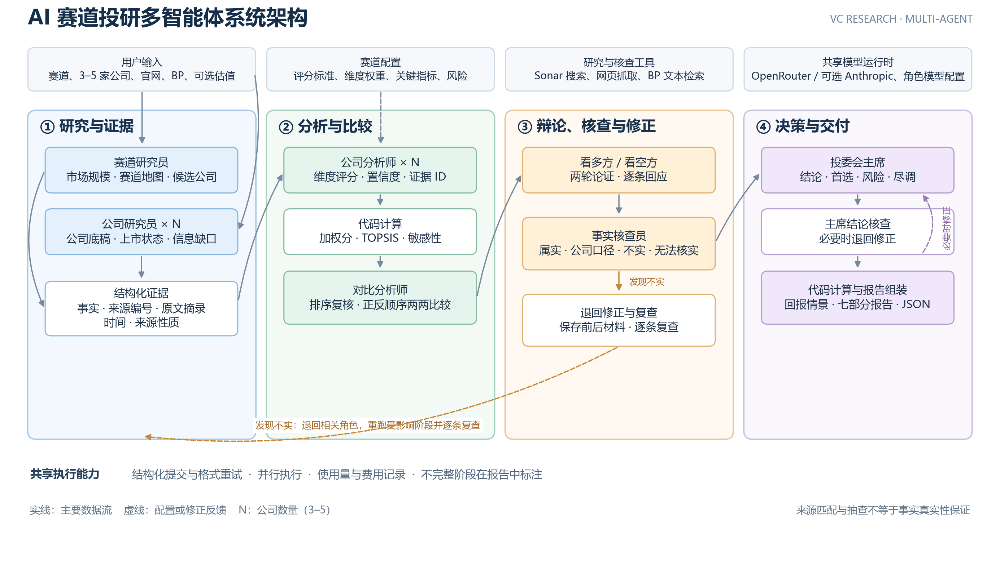

# AI 赛道投研多智能体系统：架构说明

> 当前默认采用 AgentScope 四个主Agent、带版本校验的结构化交接、受控记忆和实际十页 PDF 门槛。请优先阅读 [当前架构](four_main_agents.md)。以下图示和说明保留为迁移前架构记录。

**图 1｜系统总体架构。** 系统由输入与配置、研究与证据、分析与比较、辩论与核查、决策与交付组成。实线表示主要数据流，虚线表示配置或修正反馈；N 为本次研究的公司数量。高清位图见 [architecture.png](architecture.png)，可编辑矢量图见 [architecture.svg](architecture.svg)。

图展示了可开启的完整流程；当前默认一轮多空观点，正反顺序两两比较改为可选。报告质量、原文门槛和新增计算的当前实现见 [报告质量说明](report_quality.md)。

重绘图可安装 `matplotlib` 后运行 `python docs/render_architecture.py`；脚本使用 Windows 自带的微软雅黑字体，已生成的 PNG 和 SVG 不要求运行脚本。

## 研究目标与输入

系统面向风险投资的立项前研究。用户指定 AI 细分赛道、3–5 家公司，或由赛道研究员推荐候选公司；可为每家公司提供官网、BP 和本轮投后估值。赛道 YAML 配置给出评分维度、权重、关键指标、参考来源与赛道风险，角色模型由 `models.yaml` 配置。网页和命令行均调用同一条 `SectorPipeline` 流程。

## 阶段一：研究与证据

用户指定公司时，赛道研究员与各公司研究员并行运行；未指定公司时，先由赛道研究员推荐，再启动公司研究。研究员可通过搜索与网页抓取获取公开信息，公司研究员还可检索其对应的上传资料。事实核查员可以按公司和文件名检索各公司的上传资料。

研究输出包括赛道综述、公司事实底稿、上市状态、信息缺口、来源列表和结构化证据。研究员判为已上市的公司不进入投资候选排序；上市状态待核实的公司会被标注，不能当作已确认的未上市标的。上市状态同样依赖研究员和资料，不能保证自动判断准确。每条证据包含事实、来源编号、摘录、时间和来源类型；程序为证据分配编号，并检查该编号引用的来源是否出现在来源列表中。编号匹配只能说明来源条目存在，不能证明摘录真实或来源支持该事实。

## 阶段二：公司分析与比较

公司分析师依据相同赛道评分标准，分别为各公司提供维度评分、置信度、理由和关联证据编号。程序对评分范围及可引用的公司证据编号进行校验；加权分和 TOPSIS 由代码计算。系统逐次将单家公司单个维度加减一分，检查首位是否变化；对低置信度或没有关联且原文匹配的独立来源维度，另外展示按 1–10 分变化的加权分假设范围。对比分析师解释公司差异与排序；正反顺序两两比较可选开启。来源性质仍依赖资料和模型识别，关联不等于事实已核实；两种排序方法共享模型输入分数，因而不能相互证明原始评分正确；假设范围不是统计置信区间或投资成功概率。

对于公司 \(i\) 和评分维度 \(j\)，加权分为：

\[
S_i = \sum_{j=1}^{m} w_j s_{ij}, \qquad \sum_{j=1}^{m} w_j = 1
\]

其中 \(w_j\) 为赛道权重，\(s_{ij}\) 为 1–10 分。TOPSIS 对加权归一化后的各公司计算到理想点和负理想点的距离 \(D_i^+\)、\(D_i^-\)，再计算接近度 \(C_i = D_i^-/(D_i^+ + D_i^-)\)。实际排序以加权分为主，TOPSIS 用于交叉检查及加权分相同时的辅助排序。

## 阶段三：多空辩论、事实核查与修正

看多方和看空方默认各给出一轮观点；可选第二轮分别接收对方上一轮结果。事实核查员随后分两批（研究材料、分析与辩论）抽查关键主张，每批最多 8 条，输出属实、公司口径、不实或无法核实，并给出实际读取的核查来源与短原文。代码核对同源摘录；没有匹配原文的肯定或否定结论降为无法核实，保留模型原判。公司自报不计入独立证据支持率；摘录存在仍不能证明语义支持。

对于被判“不实”的主张，系统将核查意见交给原角色修正，保留原材料与修正后材料，重新运行受影响的分析、对比与辩论，并要求核查员对原不实主张逐条复查。若复查无法确认修正或仍发现不实主张，流程停止生成最终报告。核查员可能遗漏主张，因此通过率只描述抽查结果。

## 阶段四：决策与交付

投委会主席综合赛道研究、公司排序、比较、辩论和核查结果，输出结论、推荐公司、风险、退出情景与尽调清单。主席新产生的关键事实再次经过核查，发现不实时进行修正与复查。退出回报倍数由代码基于用户提供的投后估值、退出估值及稀释假设计算。

简化回报倍数为 \(M = V_{exit}(1-d)/V_{post}\)，其中 \(V_{exit}\) 是情景退出估值，\(V_{post}\) 是用户提供的本轮投后估值，\(d\) 是后续持股稀释比例。用户提供持有年数后计算无中间现金流的简化年化 IRR，提供完整主观情景权重后计算期望倍数。未知估值为 null，0 代表全损。可选结构化经营与市场输入由代码计算指标并保留来源说明；输入缺失不补造。

系统生成七部分 Markdown 报告和 JSON 结果。报告包含公司分析、评分依据、多空观点、来源、抽查结果及运行指标；JSON 额外保留结构化证据、检查历史与修正前后材料。核查未完成或角色失败时，报告记录对应错误；流程因普通异常中断时保存部分 JSON，进程被强制终止时不保证保存。

## 共享执行能力与边界

模型调用通过 OpenRouter 的 OpenAI 兼容接口，也支持按角色配置 Anthropic 直连；研究员和事实核查员使用联网工具，其余角色接收结构化结果。每个角色使用结构化提交、格式校验和有限重试；公司研究及分析可并行执行。系统记录模型 token、搜索次数、耗时和接口返回的费用，缺失的费用不能按零处理。

该系统生成研究草稿，不自动保证事实真实、覆盖所有事实或预测投资回报。BP 文本使用 PDF 文本提取，扫描件没有 OCR。真实模型的质量、成本和耗时应通过实际案例与人工审阅验证。

## 主要实现位置

| 模块 | 文件 |
| --- | --- |
| 网页与命令行 | `app.py`、`cli.py` |
| 阶段编排、核查与修正 | `vcagents/pipeline.py` |
| 角色职责与提示词 | `vcagents/roles.py` |
| 输出格式、证据与校验 | `vcagents/schemas.py` |
| 模型和工具调用循环 | `vcagents/llm.py`、`vcagents/agent.py`、`vcagents/tools.py` |
| 评分、排序、回报与报告 | `vcagents/scoring.py`、`vcagents/report.py` |
