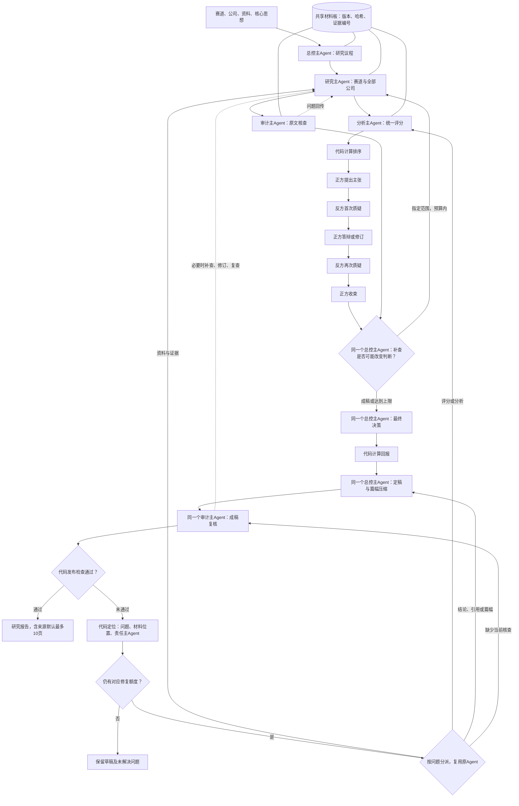

# 默认架构 · 四个模块、五个 Agent

总控、研究、投资分析、审计共四个模块。投资分析模块由正方和独立反方组成。五个 Agent 各自复用上下文，数量与公司数无关。

| 主 Agent | 负责内容 | 默认模型 |
| --- | --- | --- |
| 总控与决策 `lead` | 核心研究命题、优先因素、反证检验、最终建议、统一正文 | Gemini 4 Carbon |
| 资料研究 `research` | 赛道与全部公司、原文读取、上传资料、记忆检索、问题补查 | Kimi K3.1 Pro |
| 投资分析 `analysis` | 全部公司评分与比较，提出、修订并收束正方主张 | Claude Fable 5.2 |
| 独立反方 `bear` | 针对最近主张连续检验两轮，给出验证条件 | GPT-6.2 Astra |
| 独立审计 `audit` | 研究事实核查、问题复查、成稿事实与核心投资推论核查 | GLM-5.3-Prime |

五个角色的模型由 `models.yaml` 配置。`search` 提供搜索工具。

## 流程



每版材料有五次依次进行的辩论发言。正方先给可检验的结论，说明事实直接支持到哪里。反方用现有材料自行推理，追问最薄弱的前提或提出能解释同一事实的另一种可能。正方随后给出当前结论和理由，可以用事实或逻辑反驳异议、维持结论，也可以收窄或替换原判断。反方再检验一次。第五次发言同时提交最终主张、答辩理由、待验证条件和更新后的公司比较。总控补查与决策都使用收束版比较，并可回看全部发言。独立审计可与评分和辩论并行。研究补查或分析修正产生新版本时重新比较并完成两轮交锋。

## 保留原框架的增量研究循环（2026-11-17）

原七部分投资报告、赛道评分标准、代码计算、原文引用、事实与核心推论审计、定向修复和含来源页数上限出口继续使用（2026-11-17 起上限为25页）。新增步骤位于原研究核查之后、最终决策之前；总控角色Prompt仍为自然语言，阶段交接和问题状态用JSON。

- `research_state` 保存问题编号、初始与当前假设、竞争性解释、证据、判断影响及缺口。如实区分用户指定对象与系统推荐，保留初始研究议程。
- 总控默认最多追加一轮研究，配置 `research_refinement_rounds=0..2`，每轮最多两项指定范围任务，支持提出新问题。无可行渠道、重复任务、无材料变化或剩余总时限较短时停止追加，保留缺口，继续原报告流程。
- 单家公司补查保留其他公司底稿和评分，更新受影响分析后重新进行统一比较与研究事实审计；赛道变化则重新评估所有公司。补查不消耗原事实纠错的一轮额度。
- `research_iterations` 记录每次决策、实际任务、材料版本、执行结果和方法评价。材料变更会使旧问题回答及方法评价失效，不能靠旧审计放行新材料。
- 补查或可选决策在更新材料前失败时，保留原研究；更新材料后下游失败则保留部分结果并停止，不能导出旧结论。版本冲突、取消和总预算停止信号始终继续上抛。
- 实际执行的方法由原审计Agent复核；正式导出时进行离线案例检查，确认当前研究版本、公共快照、事实支持、执行交接和发布状态后才写入独立 `research_method_memory` 表。含私有上传资料、演示、草稿、未执行、旧版本和仅自我确认的候选不能入库。
- 方法经验按版本与案例数检索到下一次总控规划，作为研究路径线索；不会升级为公司事实，不自动改写角色Prompt。离线回放命令为 `python -m evaluation.research_method_replay <result.json>`。

完整运行过程放在 `audit.md` 和结构化结果中。Gemini 3.1 Flash-Lite 按需核对引用写法和成稿金额。

## 发布未通过后的定向修复

发布预检现在位于实际 Pipeline 中，先定位，再修复，再独立复查并重新执行代码检查。原有研究补查最多一轮；发布退回的定向修复默认最多两轮，由 `Settings.publication_repair_rounds` 配置（0–3）。达到对应上限、仍缺少证据或输入、修复未被确认时，保留草稿，不继续无限重试。

| 问题 | 责任角色与处理 | 修复后重新执行 |
| --- | --- | --- |
| 原始底稿的事实或证据有误 | 原研究Agent按定位的问题补查或删除，沿用未受影响材料 | 下游评分、排序、比较、决策、正文、独立复查 |
| 某家公司分析出现无依据数字 | 原分析Agent只重新提交涉及公司的分析，其他公司的分数保留 | 代码排序、比较、最终决策与正文、独立复查 |
| 结论冲突、引用不完整、篇幅超限 | 原总控Agent修订相关叙述，回报数字继续使用代码计算 | 最终事实与推论复查、引用与实际页数检查 |
| 当前稿未核查或审计接口失败 | 原审计Agent核查当前版本或重试，不重写有效研究与正文 | 代码发布检查 |

诊断是代码服务，不是第五个Agent。每个问题包含 `issue_id`、`kind`、`owner`、`location`、`target` 和 `message`，随材料版本写入共享板的 `quality`。未通过不只返回一段错误文本，而是返回可定位的修复任务。

公司分析的上游定位限定在该公司与赛道资料中，不能因为另一家公司底稿出现相同文字，就把问题误派到另一家公司。

审计的 `repair_checks.claim_id` 必须覆盖当前问题编号。文字发生修改不能自动关闭问题；“仍存在”“无法判断”或未复查继续阻止出稿，新一轮发现的问题也不会因旧问题通过而被覆盖。测量通过的篇幅问题可以由代码关闭，事实与推论问题须独立复查。

`result.json` 的 `quality_issues` 保存当前阻塞项，`quality_checks` 保存每轮预检和材料版本，`quality_repairs` 保存责任角色、操作、前后版本、已关闭问题与失败原因。内部审计文件同时展示退回与修复记录。正常流程通过时不增加模型调用。

`save_result()` 继续只负责导出与最后的独立安全检查，不在保存文件时偷偷调用模型。Pipeline 已在导出前执行同样的正文、证据与真实PDF页数预检；运行结束后若有人再修改结果，导出仍会拒绝有问题的正式报告。

## 并行保留在哪里

- 研究主 Agent 可以并行调用独立的搜索与原文读取工具。
- 研究材料完成后，分析主 Agent 与审计主 Agent 可以同时工作，读取同一材料版本。
- 评分一完成，代码计算排序并立即开始比较，不等待研究审计结束。比较只读研究包和排序，不读尚未完成的审计；审计结论由总控决策时合并。评分或比较失败时整轮作废，仍在排队的审计随即取消，不再产生费用。
- 公司数量是结构化材料的行数，不决定 Agent 数量。

## 运行管控

`RunGovernor`（`vcagents/governor.py`）是每次运行一个的代码服务，不是 Agent。模型客户端、搜索工具、网页读取和任务调度共用它：

| 机制 | 行为 | 配置 |
| --- | --- | --- |
| 总时限 | 每次请求的超时不超过剩余时间；到时后不再发起新的模型与工具调用，抛出 `RunTimeout`，保存部分结果 | `run_timeout_seconds`，默认 5400 |
| 取消传播 | `pipeline.cancel()` 可从其他线程调用；网页停止、命令行 Ctrl+C 都会触发。工具把停止信号直接上抛，不当作普通工具错误交给模型 | — |
| 重试预算 | 受管控的请求关闭 SDK 自带重试，所有重试从整轮预算中扣除，并按退避或 `Retry-After` 等待 | `retry_budget`，默认 12 |
| 供应商配额 | 按模型名前缀（如 `google`、`perplexity`）分组限制并发与每分钟请求数，收到 429 时整个供应商队列一起等待 | `provider_concurrency`、`provider_rpm` |
| 请求去重 | 本轮内相同的搜索问题（忽略大小写与空白）和相同网址只执行一次，并发的重复调用等待同一结果；失败结果不缓存。各 Agent 仍各自登记读取记录与引用编号 | — |
| 费用上限 | 每次响应返回费用即累计，达到上限后停止 | `cost_budget_usd`，默认不限 |

实际用量写入 `result.json` 的 `run_control` 和 `audit.md` 的“运行管控”。`task_trace` 记录每个任务的开始时间，便于确认哪些阶段确实重叠。

## 研究核查覆盖门槛

研究核查不再只靠模型自选最多 6 条。代码按事实类型（估值、融资、收入、客户、合作优先）为每份材料列出必查证据：赛道 1 条，每家公司 `audit_claims_per_company` 条（默认 2）；证据不足时按实际条数，至少 1 条。核查条数上限随之放宽。

审计提交时，代码检查每份材料的条数和必查证据编号（写在对应主张的 `evidence_ids` 中）；不足则退回审计主 Agent 补查，其他公司的主张不能顶替。提交后仍不足时记为 `audit_coverage` 错误，发布检查将其派回审计主 Agent 重试，仍不足则保留草稿。覆盖情况写入 `result.json` 的 `audit_coverage` 和 `audit.md` 的“研究核查覆盖”。演示模式没有真实来源，只记录清单，不作为门槛。成稿的核心推论逐项复核保持不变。
- 正方与反方各自承担论证，最终建议由总控作出，独立核查由审计负责。

## 问题驱动研究与结构化观点

在上一节增量循环的基础上，本节调整了 `brief.py` 的报告内容（七部分标题不变），使报告围绕研究问题展开，而不是按模板罗列资料：

- **研究取证**　研究主 Agent 围绕问题查阅定价页、上游模型报价、产品更新等一手资料，如实记录支持或削弱假设的事实。某个问题只找到单侧材料时也可提交。
- **分析反驳**　每轮反方从正方最新发言中选择一项具体结论或理由。程序把选中的原话记在 `addressed_claim` 并交给总控。反方说明推导缺口如何影响这项判断，或说明为何认同。替代解释写明条件与验证方法，只有已定位的相反事实才填入 `contradicting_evidence_ids`。正方回应给出当前结论、适用范围和理由，若暂缓判断则说明已知事实、关键缺口和能改变判断的观察。
- **补查门槛**：总控补查决策只在研究核查缺失时跳过。被独立审计判为不实或无法核实的证据记入 `research_iterations[].excluded_evidence_ids`，从回答依据和补查决策的可引用编号中排除，但不再阻止整个问题循环。这些问题仍由原纠错与发布检查处理，不能借补查放行。
- **分析观点字段**：分析主Agent为每家公司提交 `standout`（最突出的一点及胜出机制）、`competitor_diffs`（与最接近竞对的差异，1–3条）、`cost_structure`（研发投入、交付成本、用户总成本、获客成本）与 `long_term_edge`（行业、竞对、技术、商业模式、收入、成本各一条）。代码检查六个维度各一次、引用的证据编号确实存在。成稿复核时，总控只修订重点公司的完整观点及每家公司的最突出一点。
- **决策字段**：总控提交 `core_answer`（核心问题的直接回答）、`question_answers`（最多3个关键问题，编号限于当前研究状态，不可重复）、`selection_view`（对照用户选择理由说明证据支持程度）与 `gap_impacts`（最多3条信息缺口及其影响）。`core_answer` 与每个问题回答都加入审计的推论复核目标（`C1`、问题编号），正文改写后旧复核失效。
- **报告呈现**：第一章从核心问题、回答与关键问题展开；第三章列各公司最突出的一点；第六章展示重点公司的竞对差异、成本结构与长期竞争力；第七章增加信息缺口影响和研究过程。研究过程由已记录的状态计数生成，不由模型叙述。七部分标题不变；页数上限随后调整为25页。
- **提示词版本**：`result.prompt_versions` 记录角色提示词和 `prompts/` 文件的内容哈希，作为后续离线评测与提示词迭代的归因基础。运行中不自动修改提示词。

## 如何减少交接错误

`MaterialBoard` 保存研究计划、研究包、分析、研究核查、决策、成稿和最终核查的版本。交接引用包含材料名、递增版本号和 SHA256：

```json
{"name": "research", "version": 2, "sha256": "..."}
```

接收阶段按固定 JSON Schema 处理材料，关键主张引用证据 ID。代码在执行前后检查版本与内容哈希。读者拿到的是副本，无法修改他人的原始事实；旧版本或被篡改的交接会被拒绝，不能静默进入下一步。

研究材料修正后，评分、比较、决策和回报意见失效，必须根据新版本重新生成。修正仍由原研究、分析与审计 Agent 完成，不生成临时纠错 Agent。研究修正最多一轮，仍有问题则保留草稿，不能正式发布。

修正后的研究包重新核查，问题编号区分研究版本。新一轮研究核查与原问题处理复查的结果一起保留；“旧问题已删除”不能覆盖新发现的不实或无法核实主张。新一轮研究核查没有完成时，即使原问题复查通过，也只能保留草稿。

`source_agent` 为兼容历史结果保留，指材料位置，例如 `company_researcher:Alpha`，不表示又创建了一个公司 Agent。实际 Agent 清单由 `result.json.main_agents`、`usage` 与运行对象共同记录；每阶段交接记录在 `handoffs`，材料当前版本在 `material_versions`。

## 保留的代码服务

以下服务不计入 Agent 数量：原文快照、受控研究记忆、证据定位、数值匹配、评分排序、财务与市场测算、PDF 排版及发布检查。

输入表和代码测算通过 `[U-1]` 引用。它们不作为其他未引用事实的佐证；例如退出估值与某个收入数字碰巧相等，不能据此放行该收入主张。

记忆继续区分历史事实、研究判断与纠错。历史记忆仅作线索，重新读取原文后才能作为本次证据；上传资料按公司前缀隔离。事实写回仍须经过来源、核查与发布门槛。

报告含来源及附录默认最多 10 页，`report_max_pages` 可在 1–25 页间设置，成稿字数预算按所选页数换算。首次预检超限时由总控压缩，再交审计核查。发布前仍超页则定向修复并复核。额度用完仍超页时，保留研究材料与状态稿。

## 入口与兼容

- 网页默认四个模块、五个 Agent：`python -m streamlit run app.py`。
- 命令行默认四个模块、五个 Agent：`python cli.py --sector aigc-content --company Alpha --company Beta --company Gamma --mock`。
- Python 默认导出 `vcagents.SectorPipeline`，指向 `MainAgentPipeline`。
- 原细分流程作为 `ExpandedSectorPipeline` 保留，命令行须显式选择 `--agent-layout expanded`。
- 默认模式固定两轮反驳、五次发言。自定义轮数或额外两两比较使用 expanded 模式。

核心代码是 `main_pipeline.py`、`main_roles.py`、`handoffs.py`、`quality.py`、`report_checks.py` 和支持持久上下文的 `runtime.py`。原证据、计算、纠错后复核和报告门槛继续由底层模块执行。
