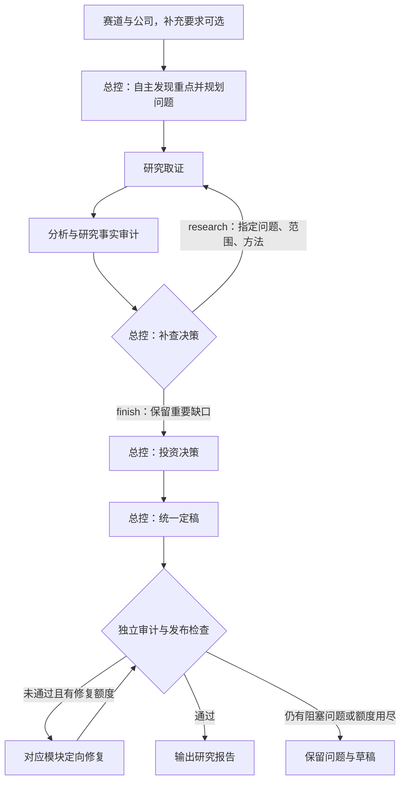

# 当前总控Agent：输入、输出与执行闭环

核对日期：2026-11-18。总控是同一个持久AgentScope对象，分四个阶段复用上下文；其他三个主Agent分别负责研究、分析和独立审计。Python流程执行任务交接、版本检查、预算、重算与发布检查，总控不能任意创建子Agent或自行宣布审计通过。

网页默认只需要选择赛道并指定公司，或选择由研究员推荐。发现研究重点、提出问题和安排验证属于系统职责，无需用户填写研究提纲。额外背景、专项问题和已有观点放入默认收起的“补充要求（可选）”，留空时总控仍自主制定完整研究议程；常规研究框架保留，深挖资源集中到最能改变决策的少数不确定性。



## 四个阶段

| 阶段 | 主要输入 | 结构化输出 | Prompt |
| --- | --- | --- | --- |
| 规划 | 赛道、公司名、可选背景与专项要求、历史纠错与经复核的方法线索；主线与假设由系统提出 | `core_question`、`working_hypothesis`、`priority_factors`、`disproof_tests`、`research_questions`、`report_focus` | [规划](../prompts/lead_planning.md) |
| 补查决策 | 当前问题与假设、原文证据、分析观点、比较与正反解释、事实审计及剩余额度 | `next_action`、`reason`、`working_hypothesis`、`question_updates`、`follow_up_tasks` | [补查](../prompts/research_checkpoint.md) |
| 投资决策 | 当前研究结果、结构化突出点及竞争机制、代码评分和财务测算、比较与审计 | `core_answer`、`headline`、`action`、`action_conditions`、`top_pick_thesis`、`question_answers`、`gap_impacts`及原决策字段 | [决策](../prompts/lead_decision.md) |
| 统一定稿 | 当前各章、决策、证据、评分、回报测算及问题定位 | 修订后的决策与各章内容，交原渲染和独立复核流程 | [编辑](../prompts/lead_editing.md) |

总控输入由固定角色规则与机构/赛道背景、当前阶段任务与材料、当前研究状态及阶段Prompt组成；JSON schema通过结构化输出接口约束提交。Prompt用自然语言描述判断标准，JSON保存问题、任务与结论，不要求把整段Prompt转成JSON。

2026-11-18补齐材料交接：`standout`、`competitor_diffs`、`cost_structure`、`long_term_edge`明确进入补查与初次决策输入，并标为待核验分析意见；它们不能替代原文证据。

## 收敛与行动

- 规划一个核心问题，优先选择一至三个可能改变决策的子问题。初始schema仍允许最多六个问题；一至三个是聚焦建议，不能声称已被数量校验保证。
- 每家公司提出一个最突出点；六维长期竞争力分析用于检验其持续性，不需要写成六个独立投资故事。原有行业、公司、财务及风险框架保留。
- 总控根据判断影响、可用取证渠道及区分解释的能力选择补查任务。这些价值判断由模型作出，当前没有单独的候选点评分算法。
- `next_action=research`时，流程实际调用研究主Agent，只更新指定赛道或公司；受影响分析重新执行，比较与研究事实审计更新，旧回答和依赖判断按版本失效。`finish`允许保留open或blocked问题。
- 补查每轮最多两项任务，Prompt优先一项；默认最多追加一轮，配置范围为零至两轮。轮数、预算、重复任务或没有材料变化会限制继续执行。
- 成稿保留一条首要投资逻辑T1，其余最多两条解释支持条件或重要限制；核心回答、标题与行动建议应与主判断一致。允许“护城河尚未证实”，证据相反时修改假设。
- [独立推论复核](../prompts/moat_review.md)检查当前版本T1、核心回答、行动建议和估值等判断；代码核对复核覆盖及版本，问题进入原定向修复流程。语义一致性和证据充分性依赖模型，不能保证零误判。

## 一次可执行的补查示例

假设研究公司名为A，已有Q2询问“工作流差异能否形成持续付费”，以下仅展示调度结构，不代表公司事实或真实执行记录。

```json
{
  "next_action": "research",
  "reason": "当前材料支持功能差异，但缺少持续付费与迁移成本的依据，这可能改变主判断。",
  "working_hypothesis": "工作流可能创造用户价值，能否形成持续优势仍待验证。",
  "question_updates": [],
  "follow_up_tasks": [
    {
      "question_id": "Q2",
      "question": "",
      "scope": "A",
      "method": "读取公司客户案例、定价和最接近竞对的功能原文，区分工作流效率与底层模型效果；持续付费或迁移成本无可靠披露时保留缺口。",
      "expected_impact": "决定只能称为产品亮点，还是有证据支持形成中的护城河。"
    }
  ]
}
```

问题及scope必须属于本轮研究状态；上述输出经校验后才进入实际补查。没有实测工具或人工测试记录时，只能说明文献/原文对比，不能称为产品实测，也不能把单个客户案例当作总体留存证明。

## 本次验证

补查及初次决策材料交接新增两项回归；问题驱动报告、研究循环及四主Agent三组共42项离线回归通过，相关Python编译通过。日志：`tmp/lead-insight-handoff-checks-20261118.log`。未调用真实模型，测试不能证明实际研究深度或语义收敛效果。
