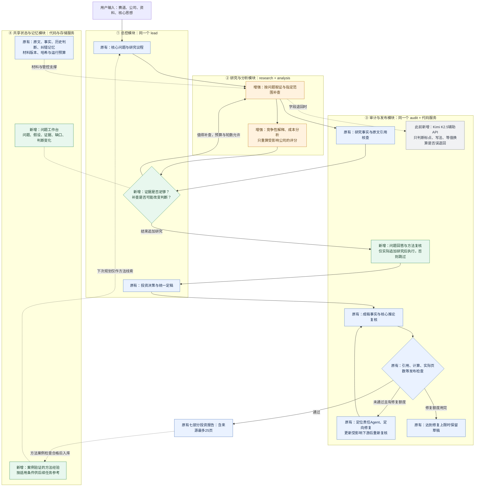

# 当前框架分模块图（2026-11-17）

AgentScope 2.0.11，四个固定主Agent：lead、research、analysis、audit。蓝色为原有能力，绿色为本次新增，橙色为本次增强，灰色为此前加入的辅助复核。比较基准是本轮问题驱动研究增强之前的四主Agent框架。

图为模块与主要流程；同名角色的不同阶段复用同一AgentScope上下文。补查方法复核是有实际追加研究时才执行的可选阶段，分析与研究事实审计可以并行。

| 模块 | 原有能力 | 本次修改提升 |
| --- | --- | --- |
| 总控 | 核心思想、研究议程、决策、定稿 | 成稿前判断补查价值；支持新问题、竞争性解释、假设更新及停止条件 |
| 研究与分析 | 搜索、读取原文、公司底稿、统一评分、比较与代码计算 | 只补查指定范围；公司补查保留其他公司底稿和评分；强化产品差异、成本口径及优势持续性分析 |
| 审计与发布 | 事实和核心推论审计、定向修复、七部分报告与25页出口 | 新增问题与实际方法复核；研究版本改变使旧回答和方法评价失效 |
| 共享状态与记忆 | 原文、事实、判断、纠错、材料板及运行管控 | 问题状态、执行与判断变化记录；方法候选通过执行、独立审计、原文和发布状态检查后入库 |

默认最多追加一轮研究，每轮最多两项任务；可配置0至2轮。补查额度与原事实纠错、发布修复额度分别管理。Kimi只处理非必要退回；总时限、重试和费用管控覆盖所有阶段。

当前落地的进化范围是案例验证后的方法复用，不能据此声称方法普遍有效。新增记录位于result.json的research_state、research_iterations、research_methods，以及audit.md。实现已通过359项离线回归；真实模型研究效果仍需实际案例验证。
